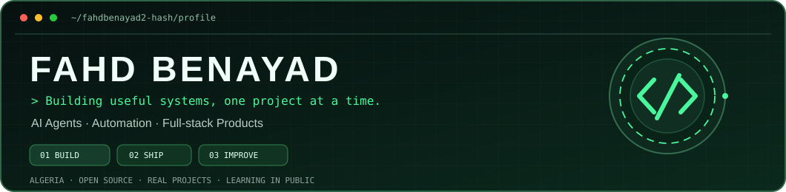
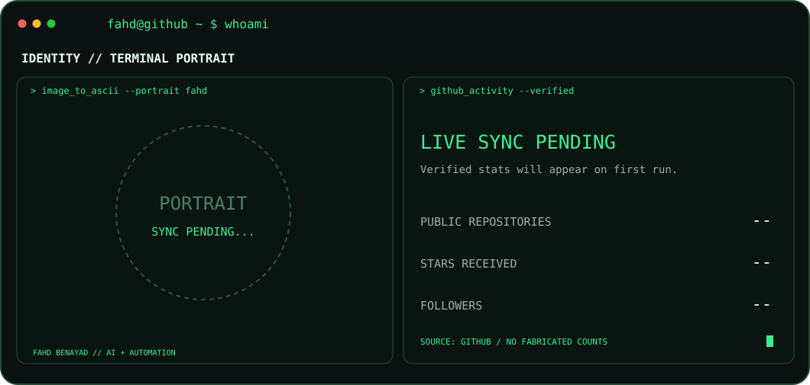

<div align="center">



<br/>


### AI · AUTOMATION · PRODUCT ENGINEERING

**بلاصتي ميش هنا** — *The journey is bigger than the starting point.*

[](https://github.com/fahdbenayad2-hash?tab=repositories)
[](https://fahdbenayad2-hash.github.io/khotwa/)

</div>

### `fahd@github ~ $ ./contributions.sh`



### `fahd@github ~ $ whoami`



### `fahd@github ~ $ ls ./projects`

| Project | What it does |
| :--- | :--- |
| **[T-Flow](https://github.com/fahdbenayad2-hash/T-Flow)** | Arabic-first COD e-commerce operations: orders, call center, delivery tracking, analytics, and team roles. Built with TanStack Start, Supabase, and a Google Sheets proxy. |
| **[DZ Commerce Intelligence](https://github.com/fahdbenayad2-hash/dz-dashboard)** | Internal business intelligence for order & shipping data from Google Sheets. Edge-served dashboard with secure, keyless Google access. |
| **[KHOTWA / خُطوة](https://github.com/fahdbenayad2-hash/khotwa)** | Personal daily focus + English learning system. Local-first PWA with IndexedDB. [Live app](https://fahdbenayad2-hash.github.io/khotwa/). |
| **[AI Agent](https://github.com/fahdbenayad2-hash/aiagent)** | Experiments with AI agents and automation tooling. |

### `fahd@github ~ $ cat about.txt`

```yaml
name: Fahd Benayad
based_in: Algeria
focus: [AI agents, Automation, Full-stack, Digital products]
approach: Build. Test. Improve. Repeat.
```

I build tools to **save time, simplify complicated workflows, and make ideas real**. Always building, always learning.

---

<div align="center">
<sub>All displayed activity metrics are fetched from GitHub. Automatic daily refresh via GitHub Actions. No invented counts.</sub>
</div>
